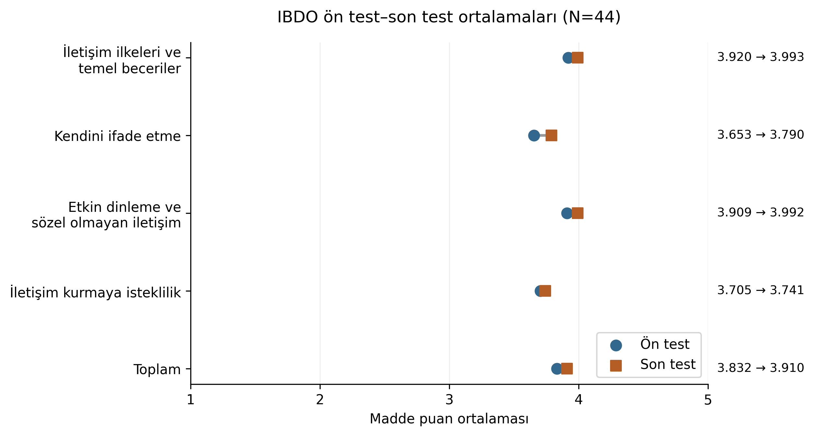
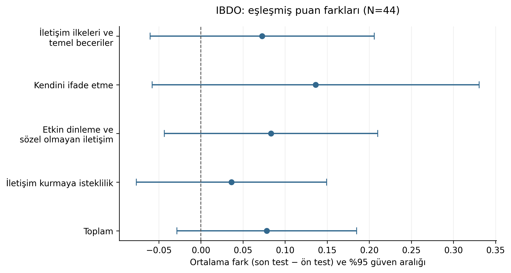
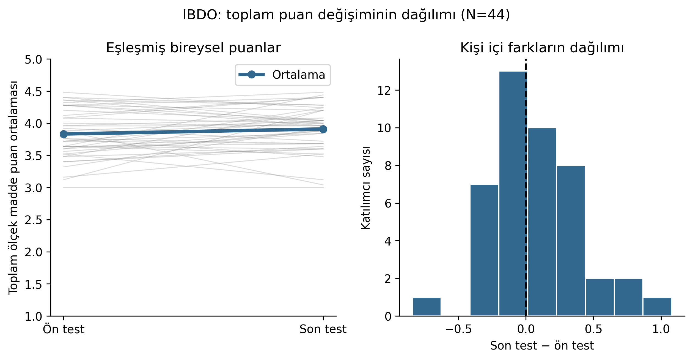

# Tez çalışma çıktıları — 20 Ekim 2026

Bu klasör, tez için hazırlanan grafik, değerlendirme ve doğrulama dosyalarını içerir. Orijinal tez ve analiz dosyaları değiştirilmemiştir.

## En güncel tez: üç grafik eklenmiş tam dosya

- **[Word — PÇBÖ ve iletişim grafikleri dahil](GOKHAN-KAYA-TEZ-3-grafik-eklenmis.docx)**
- **[PDF — PÇBÖ ve iletişim grafikleri dahil](GOKHAN-KAYA-TEZ-3-grafik-eklenmis.pdf)**

Şekil 4.1 PÇBÖ ön–son ortalamalarını, Şekil 4.2 iletişim ön–son ortalamalarını, Şekil 4.3 iletişimde ortalama farkları ve %95 güven aralıklarını gösterir. PÇBÖ grafiği kullanıcının talebi doğrultusunda mevcut GitHub kodu ve tez tablolarındaki puanlama esas alınarak eklenmiştir; hesaplar değiştirilmemiştir. Önceki iki-grafikli dosya arşiv olarak korunmuştur.

## Önceki sürüm: iki iletişim grafiği eklenmiş kopya

- **[Tezin tamamı — düzenlenmiş Word](GOKHAN-KAYA-TEZ-grafik-eklenmis.docx)**
- **[Tezin tamamı — PDF görüntüleme sürümü](GOKHAN-KAYA-TEZ-grafik-eklenmis.pdf)**
- [Neler eklendi?](TEZE-EKLENENLER.md)

Bu kopyada yalnızca iki iletişim grafiği, uygun bölüm içine başlık ve açıklamalarıyla eklendi. Eski çalışma dosyalarından farklı olarak tezin tamamını içerir. PÇBÖ taslakları bu tez dosyasına eklenmedi.

## Önceki çalışma dosyaları

- [İletişim nicel bulguları: tablolar, grafikler ve açıklamalar](iletisim-nicel-bulgular-duzenlenmis.docx)
- [Yeni belgelerin değerlendirmesi ve yöntem düzeltmeleri](yeni-belgeler-dogrulama-ve-yontem.docx)
- [Sayısal doğrulama tabloları](nicel-dogrulama.xlsx)
- [Görüşmelerin ön incelemesi](gorusme-on-inceleme.docx)
- [Kimliksiz görüşme envanteri](gorusme-envanteri-kimliksiz.xlsx)
- [İlk nicel çalışma dosyası](nicel-bulgular-calisma.docx)

Word ve Excel dosyalarını açmak için dosya sayfasındaki **Download raw file** düğmesini kullanabilirsiniz. Grafiklerin PNG sürümleri GitHub üzerinde doğrudan görüntülenebilir. PDF sürümleri de aynı klasördedir.

## İletişim grafikleri

### Ön test–son test ortalamaları

### Ortalama fark ve %95 güven aralıkları

### Bireysel değişimler ve fark dağılımı

## PÇBÖ: puanlama doğrulaması bekleyen taslaklar

PÇBÖ dosyaları mevcut depo kodunun çıktılarıdır. Ölçek formu, depo notları ve madde anahtarı arasındaki tutarsızlıklar giderilmeden kesin bulgu olarak kullanılmamalıdır. Sonuçların yeniden üretilebilmesi, puanlama anahtarının geçerliliğini tek başına doğrulamaz.

- [Taslak ortalamalar](grafikler/PCBO_ortalamalar.png)
- [Taslak farklar ve güven aralıkları](grafikler/PCBO_fark_GA95.png)
- [Taslak bireysel değişimler](grafikler/PCBO_eslesmis_dagilim.png)

## Önceki çalışmalar

[onceki-grafikler](onceki-grafikler/) klasöründeki 8 PNG, depoda daha önce bulunan notebook çıktılarından çıkarılmıştır. Yeni grafikler `grafikler/` klasöründedir.

Görüşme çıktılarında katılımcılar K1–K4 olarak kodlanmıştır. Nitel rapor bir ön incelemedir. İletişim bölümünün düzenlenmiş dosyası ilk çalışma dosyasından daha günceldir. Benzerlik oranı ölçülmemiştir.

## Toplu indirme

[Tüm çıktı dosyalarını ZIP olarak indir](tum-ciktilar.zip)
