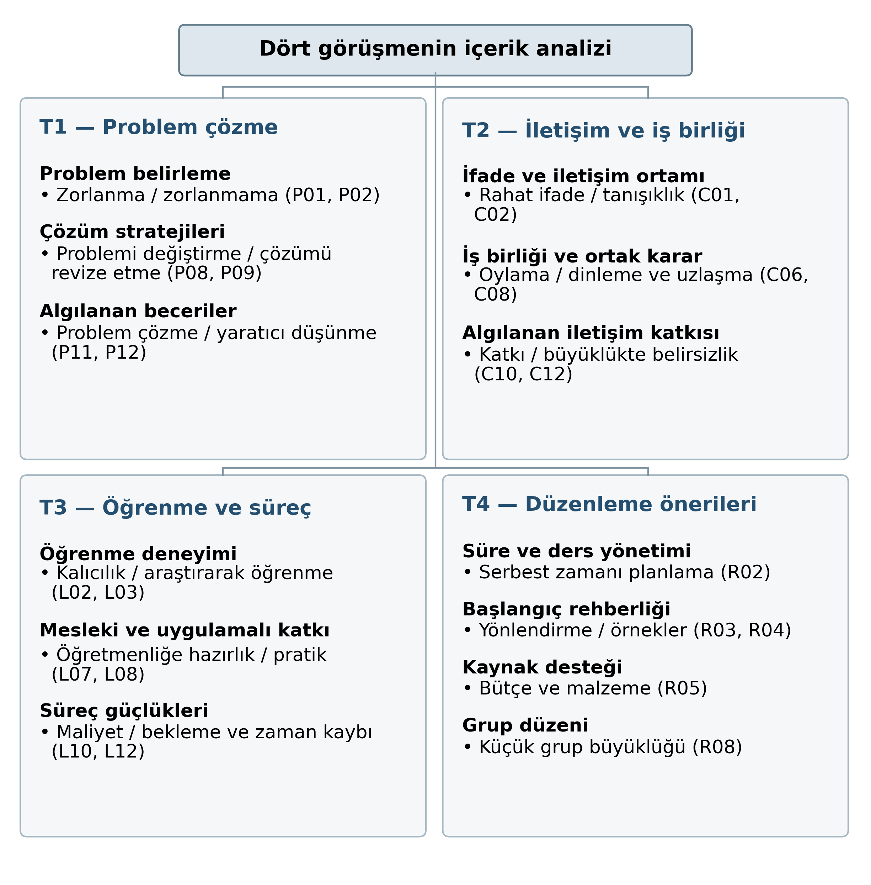

# Nitel içerik analizi — 22 Ekim 2026

Dört görüşmenin tamamı, gönderilen soru formu ve hocanın K1 için el yazısı notları esas alınarak incelendi. Ana tez dosyası değiştirilmedi.

## Önce okunacak dosya: yalnızca nitel bulgular

- **[Teze aktarılacak nitel bulgular — Word](TEZE-AKTARILACAK-NITEL-BULGULAR.docx)**
- **[Teze aktarılacak nitel bulgular — PDF](TEZE-AKTARILACAK-NITEL-BULGULAR.pdf)**

10 sayfalık metin, 4.2 bölümünü, Şekil 4.4 tema şemasını ve Tablo 4.11–4.19 olarak numaralanmış 9 bulgu tablosunu içerir. Tablo 4.19, yedi boyutta K1–K4 karşılaştırma matrisidir. Özgün bulgu açıklamaları, karşıt/belirsiz örnekler ve değiştirilmemiş katılımcı alıntıları birlikte sunulmuştur. Son kopyalama öncesinde araştırmacı ve danışman kodlamayı gözden geçirmelidir.

## Eklenen görsel ve bütünleştirme çalışması

- **Şekil 4.4 — tema–kategori–örnek kod şeması:** nitel bulgular Word ve PDF dosyalarının içinde; [PNG](sekil-4-4-nitel-tema-semasi.png) / [PDF](sekil-4-4-nitel-tema-semasi.pdf) olarak da mevcut.
- **Tablo 4.19 — katılımcı karşılaştırma matrisi:** yedi boyutta K1–K4 deneyimleri, kaynak soru numaralarıyla birlikte nitel bulgular dosyasına eklendi.
- **[Nicel–nitel ortak gösterim — Word](NICEL-NITEL-ORTAK-GOSTERIM.docx)** / **[PDF](NICEL-NITEL-ORTAK-GOSTERIM.pdf):** sonuç/tartışma ve bütünleştirme aşaması için ayrı, tek sayfalık çalışma dosyası. Ayrıntılı raporda Ek 5 olarak da mevcut; ana nitel bulgulara otomatik eklenmedi.

Şema 53 kodun tamamını sıkıştırmak yerine dört tema, kategoriler ve seçilmiş kod örneklerini gösterir. Kod tanımları, 44 yanıt, 140 kod bağlantısı, 30 alıntı ve eski frekanslar değiştirilmedi. Excel'e iki yeni özet sayfası eklendi. Ortak gösterimde bireysel nicel–nitel eşleştirme yapılmış veya belirli bir p değerinin nedeni açıklanmış gibi yorum kurulmadı. Ana tez dosyası değiştirilmedi.

## Ayrıntılı analiz ve hocanın notları

- **[Tam analiz, hocanın dijital notları ve rehber — Word](NITEL-BULGULAR-VE-ICERIK-ANALIZI.docx)**
- **[Aynı dosyanın PDF sürümü](NITEL-BULGULAR-VE-ICERIK-ANALIZI.pdf)**

26 sayfalık çalışma dosyası: nitel bulgular metni; yöntem uyumu ve eksik bilgi kontrol listesi; hocanın notlarının okunabildiği kadarıyla dijital aktarımı; dört katılımcının soru bazında kodlanması; 53 kodun tanımı ve dahil etme/dışlama sınırları. El yazısında okunamayan bir üstü çizili ifade ve belirsiz bir sözcük tahmin edilmeden işaretlenmiştir. Kişi adı yerine K1 kullanılmıştır.

## Kontrol edilebilir kod ve kanıt tabloları

- [Kodlama ve kanıt tabloları — Excel](NITEL-KODLAMA-VE-KANIT-TABLOLARI.xlsx)
- [Sayısal kontrol özeti](analiz-dogrulama.json)
- [Tüm nitel analiz dosyaları — ZIP](NITEL-ANALIZ-TUM-DOSYALAR.zip)

Excel; kod kitabı, kişi başına kod matrisi, 44 tam yanıt ve kodları, 140 yanıt–kod bağlantısı, görüşme bütünü ve soru bazında frekanslar, hocanın notları ve 30 kontrol edilmiş alıntı parçasını içerir. f, kodu belirten farklı katılımcı sayısıdır; aynı kişinin tekrarları f’yi artırmaz. Görüşme bütünü frekansları ile soru bazlı frekanslar karıştırılmamalıdır.

## Kapsam ve sınırlar

Kullanıcı dört görüşmenin gerçekleştiğini, dökümlerin kelimesi kelimesine olduğunu, görüşmecilerin rastgele seçildiğini ve görüşmelerin nicel sonuçlar görüldükten sonra uygulama bitiminde yapıldığını teyit etti. Hocanın notları ilk katılımcıya aittir. Bu notlar K1 için kısmi bir başlangıç karşılaştırmasıdır; dört kişide bağımsız çift kodlama, kodlayıcı uyumu veya danışmanın yeni kodları onaylaması olarak raporlanmadı.

Gerçek adlar yeni dosyalarda gizlendi. Ses kayıtları burada dinlenmedi. Yapay zekâ destekli bu çalışma araştırmacı incelemesi gerektirir. Görüşme süreleri, rastgele seçimin uygulanışı, etik/onam belgeleri, görüşmeci rolü ve karma desenin bütünleştirme ayrıntıları gibi henüz paylaşılmayan yöntem bilgilerinin nasıl tamamlanacağı tam raporda ayrı gösterildi. Bir benzerlik yüzdesi ölçülmedi veya garanti edilmedi.
